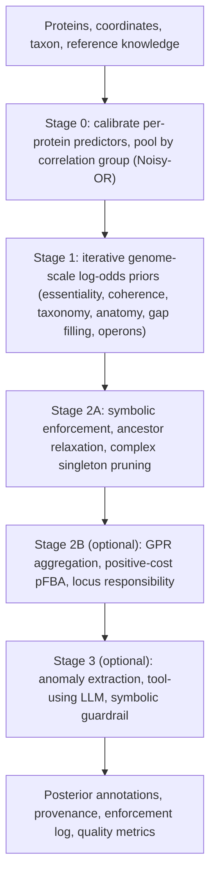

# Concepts

This section describes how GSPA turns per-protein evidence into a genome-wide annotation. It is written at the level of a methods section: each page states the inputs of a stage, the model and its equations, the hyperparameters with the command-line option or configuration key that controls them, the outputs and audit trail, and the known limitations. The command-line options themselves are documented in [gspa integrate](../reference/cli-integrate.md) and the configuration keys in [Hyperparameters (theta)](../reference/theta.md).

## The inference problem

The input is the set of protein-coding genes \( \mathcal{P} = \{p_1, \dots, p_N\} \) of one organism, their chromosomal coordinates and strands \( \mathcal{K} \), the organism's NCBI Taxonomy lineage \( \tau \), and reference knowledge: the Gene Ontology (GO), a metabolic reaction network with stoichiometric matrix \( \mathbf{S} \), and taxonomic and anatomical axioms. The output is a posterior probability for every candidate pair of protein and function (GO term or EC number), together with the evidence and priors that produced it.

Because the proteins of a genome act together in one cell or organism, a valid joint annotation satisfies invariants that span many proteins at once: the core functions required in the organism's domain of life are present, metabolic pathways form connected routes that can carry flux to biomass, obligate heteromeric complexes have their partner subunits, and assigned terms are admissible in the organism's lineage and body plan. Per-protein predictors cannot see these invariants. GSPA uses them.

## Three reasons GSPA improves over per-protein annotation

**1. Combining complementary per-protein predictors.** Sequence alignment, profile hidden Markov models, protein language model embeddings, and structural similarity capture different properties of a protein and make partially independent errors. GSPA calibrates the score of each source to a probability, groups sources that share underlying evidence so that it is counted once, and pools the groups with Noisy-OR. The result is a per-protein starting distribution that is at least as strong as the best single source and that later stages refine but never discard ([Stage 0](stage0-evidence.md)).

**2. Using whole-genome information and genomic architecture.** A genome constrains the function of each of its proteins in ways a single sequence cannot:

- co-directional operons and chromosomal neighbourhoods place genes of the same pathway or complex next to each other;
- every organism of a domain must encode an essential core (translation, transcription, replication, and so on);
- obligate heteromeric complexes need all of their subunits, so one confidently predicted subunit raises the plausibility of its partners and an isolated subunit is suspicious;
- GO taxon constraints and cross-ontology axioms that link GO processes to Uberon, Plant Ontology, and Cell Ontology anatomy rule out functions the organism cannot have.

Stage 1 turns these invariants into log-odds priors that are updated iteratively over the whole proteome ([Stage 1](stage1-priors.md)), and Stage 2A enforces the hard taxonomic and anatomical constraints deterministically, relaxing a forbidden term to its most specific admissible ancestor rather than deleting it ([Stage 2A](stage2a-enforcement.md)). This kind of inference has become practical because long-read sequencing and repeat-graph assemblers now routinely produce complete or near-complete chromosomes, for cultivated isolates and for metagenome-assembled genomes alike, so gene order, strand, and the complete protein complement are standard inputs rather than exceptions.

**3. Going beyond homology through systems biology.** Many divergent enzymes have no informative homologue, and a reaction-level gap does not say which gene fills it. GSPA adds five mechanisms that use the metabolic network and the genome together:

- *reaction-local genomic context* (RLGC) ranks candidate genes for a missing reaction by their chromosomal proximity and strand agreement with genes that catalyse neighbouring reactions in the reaction graph ([Stage 1](stage1-priors.md#reaction-local-genomic-context));
- *role-aware aggregation* of gene-protein-reaction (GPR) rules in disjunctive normal form treats alternative isozymes with OR and required subunits with AND, so a reaction is not supported by one subunit of a complex alone ([Stage 2B](stage2b-fba.md));
- *positive-cost parsimonious flux balance analysis* repairs the network with a minimal set of reactions that actually carry flux to biomass, avoiding the zero-flux padding that negative-cost gap filling produces ([Stage 2B](stage2b-fba.md));
- *locus responsibility* distributes the support for each repaired reaction competitively over candidate genes and an explicit unassigned-gene hypothesis, instead of raising every paralog equally ([Stage 2B](stage2b-fba.md));
- *selective, guarded language-model reasoning* inspects the few anomalies that remain after deterministic inference (fewer than 2.5% of proteins per proteome in the published multi-kingdom evaluation), and every proposal is checked by a symbolic ontology guardrail before it is accepted ([Stage 3](stage3-agent.md)).

## Pipeline

All stages are run by [`gspa integrate`](../reference/cli-integrate.md) on a file of evidence claims, or end to end from a genome by [`gspa annotate`](../reference/cli-annotate.md). Stage 1 always runs with the priors selected by `--enable-priors` (all six by default). Stage 2A runs when `--enforce-stage2` is given. Stage 2B runs when `--enable-fba-refiner` and `--fba-data-dir` are given. Stage 3 runs when `--enable-agent` is given and an OpenAI-compatible model endpoint is reachable.

Each stage only adds to the log-odds that come before it, and each change is recorded under a named key in the provenance of the affected annotation, so the final posterior of any protein-function pair can be decomposed into its per-protein evidence and the genome-scale contributions that moved it.

## Calibration and frozen hyperparameters

The published hyperparameters (prior strengths, damping, convergence tolerance, and the Stage 2B parameters) were calibrated once on *Escherichia coli* K-12 MG1655 and held fixed for all other organisms. They are the defaults in the code. You can override the Stage 0 and Stage 1 values with a JSON file passed to `--theta`; see [Hyperparameters (theta)](../reference/theta.md).

## Pages in this section

| Page | Content |
|---|---|
| [Per-protein evidence (Stage 0)](stage0-evidence.md) | Evidence channels, Platt calibration, reliability weights, correlation groups, Noisy-OR pooling |
| [Genome-scale priors (Stage 1)](stage1-priors.md) | The six priors, reaction-local genomic context, damped iteration and convergence |
| [Symbolic enforcement (Stage 2A)](stage2a-enforcement.md) | The cross-ontology constraint bridge, enforcement modes, semantic ancestor relaxation, singleton pruning |
| [Flux-certified locus refinement (Stage 2B)](stage2b-fba.md) | GPR aggregation, positive-cost lexicographic pFBA, flux certificates, locus responsibility |
| [Agentic completion (Stage 3)](stage3-agent.md) | Anomaly triggers, tools, the symbolic guardrail, how proposals change posteriors |
| [Genome-scale quality metrics](quality-metrics.md) | Completeness, coherence, consistency, the composite audit score, and protein-level metrics used in the benchmarks |
