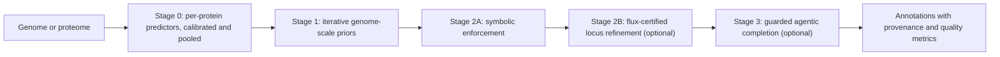

# GSPA: genome-scale protein annotation

GSPA predicts the functions (Gene Ontology terms and EC numbers) of all proteins in a genome jointly. Standard annotation pipelines and protein language model predictors annotate each protein in isolation. GSPA treats the whole genome as the unit of inference: it starts from calibrated per-protein evidence and refines it using what the rest of the genome says about each protein.

GSPA runs on bacterial, archaeal, eukaryotic, and viral genomes, on isolate assemblies and on metagenome-assembled genomes (MAGs).

## Why whole-genome inference helps

GSPA improves over per-protein annotation for three reasons, and the pipeline is organised around them.

1. **Combining complementary per-protein predictors.** Sequence homology, domain profiles, protein language models, and structural similarity make different errors. GSPA calibrates each source and pools them into one starting distribution per protein ([Stage 0](concepts/stage0-evidence.md)).
2. **Using whole-genome information.** A genome is more than a bag of proteins. Operons and chromosomal neighbourhoods, the essential core every organism of a domain must encode, the subunit stoichiometry of obligate complexes, and taxonomic and anatomical consistency all constrain which functions are plausible ([Stage 1](concepts/stage1-priors.md), [Stage 2A](concepts/stage2a-enforcement.md)). Long-read sequencing and modern assemblers now routinely recover complete or near-complete chromosomes, so this information is available for most new genomes.
3. **Going beyond homology with systems biology.** Many proteins have no informative homologue. GSPA uses the metabolic network itself: reaction-local genomic context, gene-protein-reaction logic for isozymes and subunits, flux-certified network repair with parsimonious flux balance analysis, and competitive assignment of reactions to genomic loci ([Stage 2B](concepts/stage2b-fba.md)). An optional, guarded language-model agent resolves the small set of anomalies that remain ([Stage 3](concepts/stage3-agent.md)).

## Where to go next

| I want to | Go to |
|---|---|
| Install GSPA | [Installation](installation.md) |
| Run GSPA on a genome in five minutes | [Quickstart](quickstart.md) |
| Follow a workflow for my type of data | [Usage scenarios](scenarios/index.md) |
| Understand the model behind each stage | [Concepts](concepts/index.md) |
| Look up every command-line option | [Reference](reference/index.md) |
| Reproduce the published evaluation | [Benchmarks](benchmarks/index.md) |

## Citing GSPA

If you use GSPA, please cite the GSPA manuscript (see `paper/` in the repository) and METEOR, the earlier metabolic gap-filling work on which Stage 2B builds (Pacific Symposium on Biocomputing 2027).

## License

GSPA is licensed under the GNU General Public License v3.0 or later. Source code: [github.com/bio-ontology-research-group/gspa](https://github.com/bio-ontology-research-group/gspa).
