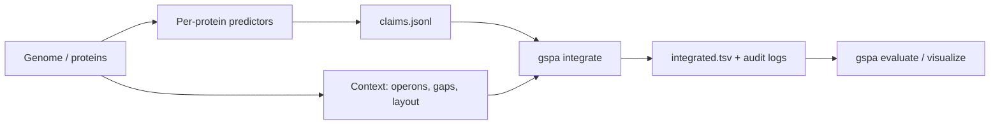

# Usage scenarios

Each page in this section is an end-to-end workflow for one use case. The pages
list the inputs you need, how to produce them, the exact commands, the options
that matter for that case, what the outputs mean, and the usual pitfalls. For the
full option lists see the [reference](../reference/index.md); for the model behind
each step see [concepts](../concepts/index.md).

## Pick a scenario

| I want to... | Page | Main commands |
|---|---|---|
| Annotate a single bacterial genome from an assembly | [Bacterial isolate genome](bacterial-isolate.md) | `annotate`, `integrate`, `evaluate`, `visualize` |
| Annotate an archaeal genome | [Archaeal genome](archaea.md) | `integrate --essential-profile archaea` |
| Annotate metagenome-assembled genomes (MAGs) or a contig set | [Metagenome-assembled genomes](mag-metagenome.md) | `annotate --mag --metrics-scope contig`, `integrate --infer-taxon` |
| Annotate a phage or other viral genome | [Viral genomes](virus.md) | `annotate -k virus`, `integrate --essential-profile virus` |
| Annotate a eukaryote, including multicellular organisms | [Eukaryotic genomes](eukaryote.md) | `annotate --genome --gff3`, `integrate --enforce-consistency-mode relax` |
| Find candidate genes for missing pathway steps | [Metabolic gaps and dark matter](metabolic-gaps-dark-matter.md) | `integrate --gaps --dark-matter`, `--rlc-suggester` |
| Re-rank enzyme loci with a flux-balance repair step | [Flux-certified refinement](fba-refiner.md) | `integrate --enable-fba-refiner` |
| Let a language model resolve the remaining anomalies | [Agentic completion](agent.md) | `integrate --anomalies-out`, `gspa agent` |
| Integrate tens to thousands of genomes in one JVM | [Many genomes in batch](batch-multi-genome.md) | `integrate --batch-manifest` |
| Transfer evidence across related genomes | [Cross-genome evidence](cross-genome.md) | `--orthogroups`, `--cluster-consensus`, `--rxn-locus-catalog` |
| Use DeepGO-PlusPlus as the per-protein base predictor | [DeepGO-PlusPlus base predictor](deepgo-plusplus.md) | `annotate --base-predictor light` |
| Score, compare and report annotation sets | [Evaluate, compare, report](evaluate-compare-report.md) | `evaluate`, `compare`, `report` |
| Browse one annotated genome in a single HTML file | [Interactive browser](visualize.md) | `visualize` |
| Run predictors and integration on a cluster | [Nextflow and HPC](nextflow-hpc.md) | `nextflow run gspa-nf/main.nf` |
| Offer genome annotation over HTTP | [Web service](web-service.md) | `POST /annotate` |

## Conventions used on these pages

- `gspa` stands for the repository launcher `./gspa` or, equivalently,
  `java -Xmx8g -jar gspa-2.2.0.jar`. The launcher sets `-Xmx8g` unless
  `GSPA_JVM_OPTS` is set, and dispatches `gspa agent` to the Python agent
  sidecar. The `agent` subcommand exists only in the launcher, not in the JAR.
- Python helper scripts live in `benchmark/` and `scripts/` and are run with
  `uv run python ...` from the repository root.
- Reference files that are not bundled (GO OWL/OBO, `ec2go`, pathway TSVs,
  GOA, gapseq/gapsmith tables) are written as plain file names such as `go.owl`;
  replace them with your local paths. See
  [Bundled resources](../reference/bundled-resources.md) for what ships inside
  the JAR.
- Output snippets marked "real output" were produced with
  `gspa-cli/build/libs/gspa-2.2.0.jar` on the *Mycoplasma genitalium* test data in
  `test-data/`. Other snippets show the format only.

## The common core

Almost every scenario is a variation of the same four steps:

1. **Per-protein evidence.** Run predictors (DIAMOND, MMseqs2, HMMER/Pfam,
   InterProScan, eggNOG-mapper, FoldSeek, neural predictors) and convert their
   output into `claims.jsonl`. See [Per-protein evidence](../concepts/stage0-evidence.md)
   and the claims schema in [Input and output formats](../reference/file-formats.md).
2. **Genome context.** Operons, metabolic gaps, genome layout, orthogroups.
   Each one is optional; a prior whose input is missing does nothing.
3. **Integration.** `gspa integrate` combines the claims, applies the
   genome-scale priors and, if asked, the enforcement, flux and agent steps.
4. **Assessment.** `gspa evaluate` computes completeness, coherence and
   consistency; `gspa visualize` renders a browser.

!!! warning "Claims that cannot be typed are dropped silently"
    Each claim needs either an `evidence_type` that is a value of the
    `EvidenceType` enum (for example `SEQUENCE_SIMILARITY`, `SEQUENCE_DOMAIN`,
    `SEQUENCE_DEEPLEARNING`) or a `source` that GSPA knows (`diamond`,
    `mmseqs2`, `pfam`, `interproscan`, `eggnog-mapper`, `foldseek`,
    `proteinfer`, `clean`, `mdf`, `deepgo`, ...). Lines with neither are skipped
    without a warning. Compare `Loaded N claims` in the integrate log with
    `wc -l claims.jsonl` after every new converter.
