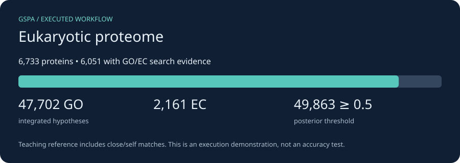

# Eukaryotic proteome: budding yeast

*2026-10-24T14:25:24Z by Showboat 0.6.1*
<!-- showboat-id: 21668041-c575-45bf-a48d-88b3c16c2f35 -->

The reviewed Saccharomyces cerevisiae S288c proteome from [UniProt](https://www.uniprot.org/proteomes/UP000002311). Supply translated proteins or trusted splice-aware gene models for eukaryotes. This run uses the supplied proteins, so it makes no new CDS predictions and has no genomic coordinates.

First complete [installation](install.md) and [data and resource setup](resources.md). Run every command from the checkout root; each command starts a new CPU container. Outputs persist in `.tutorial-work/eukaryote/`.

The compact teaching reference contains reviewed proteins from these same organisms, including self/close matches. These runs prove the workflow executes; they do not estimate accuracy. We use one DIAMOND hit per query and disable optional domain/neural predictors. No ontology was downloaded, so ontology-based quality metrics and ancestor relaxation are not demonstrated here; integration uses bundled constraint tables.

```bash
docker run --rm -i --user "$(id -u):$(id -g)" --cpus 2 --memory 6g \
  -v "$PWD/.tutorial-work:/work" -v "$PWD/tutorials/workflows:/tutorial:ro" \
  gspa-tutorial:cpu bash -eu <<'GSPA'
gspa integrate --preset eukaryote --print-config > /work/eukaryote-settings.json
python3 - <<'PYCONFIG'
import json
settings = json.load(open('/work/eukaryote-settings.json'))
for key in ['--taxon', '--essential-profile', '--enable-priors', '--enforce-stage2', '--lite']:
    print(key + ': ' + str(settings[key]))
PYCONFIG
GSPA
```

```output
--taxon: eukaryote
--essential-profile: eukaryote
--enable-priors: essentiality,coherence,consistency,anatomical
--enforce-stage2: True
--lite: True
```

Call genes where needed and search the annotation-bearing DIAMOND database. Logs retain the tool commands and diagnostics. Conversion keeps unique direct DIAMOND GO/EC claims; operon-propagated suggestions in the annotation TSV are excluded, because operon coordinates are supplied separately to integration. This avoids counting the same context twice. Its teaching score is percent identity / 100 clipped to [0.01, 0.99], not a calibrated likelihood. For production, use held-out calibration and a broader reference, and add independent predictors.

```bash
docker run --rm -i --user "$(id -u):$(id -g)" --cpus 2 --memory 6g \
  -v "$PWD/.tutorial-work:/work" -v "$PWD/tutorials/workflows:/tutorial:ro" \
  gspa-tutorial:cpu bash -eu <<'GSPA'
mkdir -p /work/eukaryote/gspa_out
gspa annotate --preset eukaryote --proteins /work/data/eukaryote.faa \
  -c /work/data/cpu.json --db /work/data/reference.dmnd \
  -o /work/eukaryote/annot -t 2 > /work/eukaryote/annotate.log 2>&1 || { tail -60 /work/eukaryote/annotate.log; exit 1; }
python3 /tutorial/results.py claims eukaryote
GSPA
```

```output
49,880 unique DIAMOND GO/EC claims from 6,051 proteins
Teaching score: DIAMOND identity fraction, clipped to [0.01, 0.99]; not a fitted probability.
```

Integrate the claims and retain provenance. Without a GO ontology, cellular consistency enforcement can remove incompatible terms but cannot relax them to an ancestor. Mixed-community and phage runs deliberately use evidence alone. The results below are counts of hypotheses, not validated functions.

```bash
docker run --rm -i --user "$(id -u):$(id -g)" --cpus 2 --memory 6g \
  -v "$PWD/.tutorial-work:/work" -v "$PWD/tutorials/workflows:/tutorial:ro" \
  gspa-tutorial:cpu bash -eu <<'GSPA'
gspa integrate --preset eukaryote \
  --claims /work/eukaryote/claims.jsonl --out /work/eukaryote/gspa_out/integrated.tsv \
  --provenance /work/eukaryote/gspa_out/provenance.json \
  --enforcement-actions-out /work/eukaryote/gspa_out/actions.tsv \
  > /work/eukaryote/integrate.log 2>&1 || { tail -60 /work/eukaryote/integrate.log; exit 1; }
python3 /tutorial/results.py summary eukaryote
GSPA
```

```output
Proteins: 6,733; with GO/EC search evidence: 6,051
Integrated hypotheses: GO=47,702; EC=2,161
Hypotheses at posterior >= 0.5: 49,863
These counts describe this teaching reference; they are not accuracy or completeness estimates.
```

```bash {image}

```



Build the interactive GSPA browser. The adapter supplies its expected metadata layout from the actual GSPA CDS coordinates (or protein IDs for yeast); it does not run Prokka or invent gene positions. GO/EC IDs remain visible because this compact example has no term-label ontology. The annotations table works locally; the genome tab may need internet access for igv.js.

```bash
docker run --rm -i --user "$(id -u):$(id -g)" --cpus 2 --memory 6g \
  -v "$PWD/.tutorial-work:/work" -v "$PWD/tutorials/workflows:/tutorial:ro" \
  gspa-tutorial:cpu bash -eu <<'GSPA'
python3 /tutorial/results.py browser eukaryote
gspa visualize -w /work/eukaryote -g eukaryote \
  --go-obo /work/data/no-labels.obo --ec2go /work/data/no-ec-labels.txt \
   \
  > /work/eukaryote/visualize.log 2>&1 || { tail -60 /work/eukaryote/visualize.log; exit 1; }
test -s /work/eukaryote/gspa_out/eukaryote_browser.html
printf 'Interactive browser generated successfully.\n'
GSPA
```

```output
Browser metadata prepared from real CDS coordinates / supplied protein identifiers.
Interactive browser generated successfully.
```

Open `.tutorial-work/eukaryote/gspa_out/eukaryote_browser.html` in your browser. Inspect `integrated.tsv` for final hypotheses, `provenance.json` for supporting evidence, and `actions.tsv` when enforcement acts. Keep the logs and `data/downloads.json` alongside results. For an actual project, replace the input and reference database; retain the biological assumptions appropriate to your unit of analysis.

Re-run this document with `uvx showboat verify docs/tutorials/eukaryote.md` after installation and resource setup.
