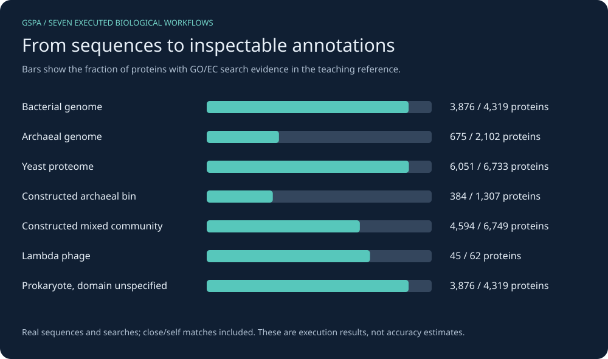
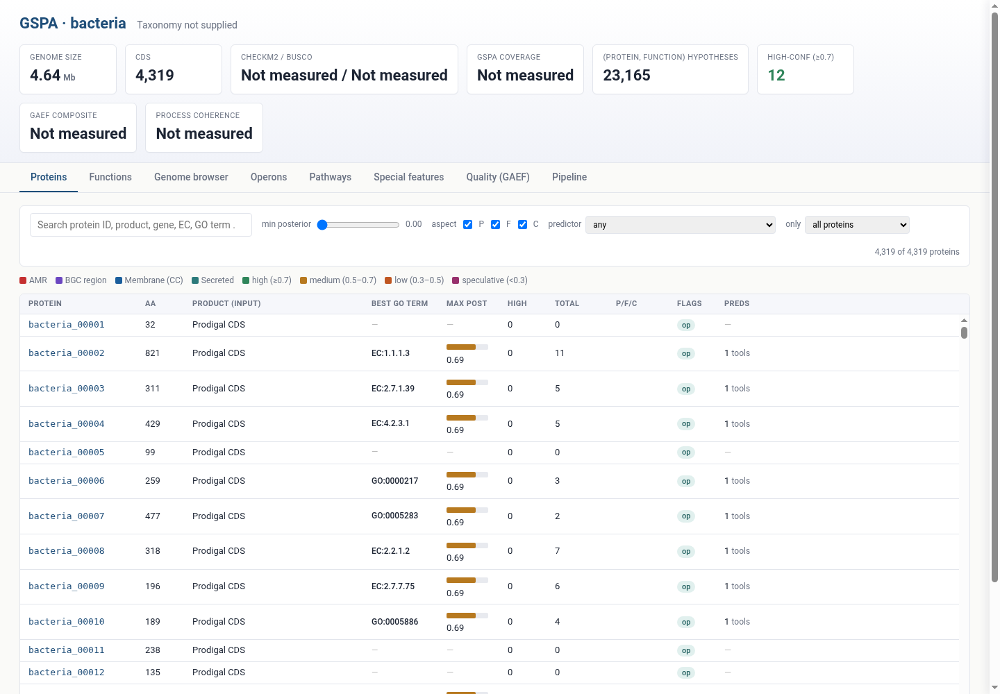

# GSPA: from a clean installation to usable annotations

*2026-10-24T14:27:08Z by Showboat 0.6.1*
<!-- showboat-id: 0190eb78-b328-4100-bbad-367ce314119e -->

These tutorials were executed and recorded with Showboat. Build GSPA in a clean Ubuntu container, prepare small public datasets, then choose the workflow that matches your biological input. The chart below comes from the actual runs.

```bash
python3 tutorials/workflows/overview.py
```

```output
Seven biological workflows have nonempty, inspectable results.
Overview chart generated from their recorded protein counts.
```

```bash {image}

```



| Start here | What you will do |
|---|---|
| [Install](install.md) | Build GSPA from source inside an unconfigured Ubuntu image |
| [Resources and data](resources.md) | Download individual models and bundled resources; prepare public sequences |
| [Bacteria](bacteria.md) | Call genes in E. coli, annotate, integrate and browse |
| [Archaea](archaea.md) | Use archaeal assumptions for Pyrococcus furiosus |
| [Eukaryotes](eukaryote.md) | Annotate a yeast proteome with supplied gene products |
| [One incomplete bin](mag.md) | Use conservative priors for a constructed archaeal bin |
| [Mixed community](metagenome.md) | Keep different organisms separate from single-genome constraints |
| [Virus / phage](virus.md) | Annotate lambda with explicit phage settings |
| [Unspecified prokaryote](prokaryote.md) | Avoid assuming a bacterial domain when it is unknown |
| [Neural CPU and GPU](neural.md) | Install both PyTorch variants and compare real ESM-2 inference |

All commands run from the checkout root and write under `.tutorial-work/`. Allow at least 25 GiB free on both the workspace and Docker storage disks. The scripts check workspace space; check the Docker data-root separately if it is on another filesystem. A CPU run needs no GPU or CUDA libraries. The optional CUDA section requires a compatible NVIDIA GPU, host driver and Container Toolkit.

The small reference includes close/self matches. The bin and mixed assembly are deterministic teaching datasets derived from real genomes. These tutorials demonstrate execution and interpretation, not predictive accuracy, biological validation, or full production database coverage. The main examples use DIAMOND; the neural example uses a tiny custom centroid reference. Optional ontology-based quality evaluation, FBA, the LLM agent and the full predictor ensemble are outside this compact collection.

Each biological case produces annotated GFF3/TSV, integration provenance, a summary chart and a local interactive HTML browser. Large downloads, models and HTML outputs remain in the workspace rather than being committed. The helpers in `tutorials/workflows/` contain the adapters and regeneration commands. The source used here includes the current working-tree usability changes; keep `source-manifest.json`, `environment.json` and `data/downloads.json` with your run.

The local HTML browser lets you filter proteins and inspect their supporting annotations. This screenshot is from the actual E. coli tutorial. Missing QC stays unmeasured; a browser page does not imply CheckM, BUSCO or ontology-based evaluation ran.

```bash {image}

```



Reproduce the collection by following installation, resource setup and your chosen biological page in that order. Each page ends with its `uvx showboat verify` command; verification reruns its computational blocks. `uvx showboat extract PAGE.md` reconstructs the recording commands. The GPU page requires a suitable NVIDIA host; its CPU section works independently. Reference checksums intentionally reject changed upstream data. See `tutorials/workflows/README.md` for refreshing inputs and regenerating the whole collection.
