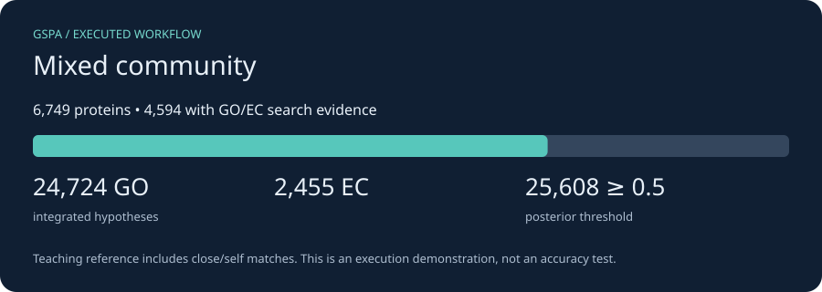

# Mixed community assembly

*2026-10-24T14:26:01Z by Showboat 0.6.1*
<!-- showboat-id: d544220d-9009-4378-96cb-16de1e5b9e05 -->

A constructed unbinned community of E. coli, Pyrococcus and lambda sequences split into separate 20 kb contigs. It demonstrates community handling, not a real metagenomic sample. The metagenome preset uses meta gene calling and disables pooled single-organism priors, taxon enforcement and operon inference. Analyze actual bins individually with the MAG workflow.

First complete [installation](install.md) and [data and resource setup](resources.md). Run every command from the checkout root; each command starts a new CPU container. Outputs persist in `.tutorial-work/metagenome/`.

The compact teaching reference contains reviewed proteins from these same organisms, including self/close matches. These runs prove the workflow executes; they do not estimate accuracy. We use one DIAMOND hit per query and disable optional domain/neural predictors. No ontology was downloaded, so ontology-based quality metrics and ancestor relaxation are not demonstrated here; integration uses bundled constraint tables.

```bash
docker run --rm -i --user "$(id -u):$(id -g)" --cpus 2 --memory 6g \
  -v "$PWD/.tutorial-work:/work" -v "$PWD/tutorials/workflows:/tutorial:ro" \
  gspa-tutorial:cpu bash -eu <<'GSPA'
gspa integrate --preset metagenome --print-config > /work/metagenome-settings.json
python3 - <<'PYCONFIG'
import json
settings = json.load(open('/work/metagenome-settings.json'))
for key in ['--taxon', '--essential-profile', '--enable-priors', '--enforce-stage2', '--lite']:
    print(key + ': ' + str(settings[key]))
PYCONFIG
GSPA
```

```output
--taxon: None
--essential-profile: None
--enable-priors: 
--enforce-stage2: False
--lite: True
```

Call genes where needed and search the annotation-bearing DIAMOND database. Logs retain the tool commands and diagnostics. Conversion keeps unique direct DIAMOND GO/EC claims; operon-propagated suggestions in the annotation TSV are excluded, because operon coordinates are supplied separately to integration. This avoids counting the same context twice. Its teaching score is percent identity / 100 clipped to [0.01, 0.99], not a calibrated likelihood. For production, use held-out calibration and a broader reference, and add independent predictors.

```bash
docker run --rm -i --user "$(id -u):$(id -g)" --cpus 2 --memory 6g \
  -v "$PWD/.tutorial-work:/work" -v "$PWD/tutorials/workflows:/tutorial:ro" \
  gspa-tutorial:cpu bash -eu <<'GSPA'
mkdir -p /work/metagenome/gspa_out
gspa annotate --preset metagenome --genome /work/data/metagenome.fna \
  -c /work/data/cpu.json --db /work/data/reference.dmnd \
  -o /work/metagenome/annot -t 2 > /work/metagenome/annotate.log 2>&1 || { tail -60 /work/metagenome/annotate.log; exit 1; }
python3 /tutorial/results.py claims metagenome
GSPA
```

```output
27,179 unique DIAMOND GO/EC claims from 4,594 proteins
Teaching score: DIAMOND identity fraction, clipped to [0.01, 0.99]; not a fitted probability.
```

Integrate the claims and retain provenance. Without a GO ontology, cellular consistency enforcement can remove incompatible terms but cannot relax them to an ancestor. Mixed-community and phage runs deliberately use evidence alone. The results below are counts of hypotheses, not validated functions.

```bash
docker run --rm -i --user "$(id -u):$(id -g)" --cpus 2 --memory 6g \
  -v "$PWD/.tutorial-work:/work" -v "$PWD/tutorials/workflows:/tutorial:ro" \
  gspa-tutorial:cpu bash -eu <<'GSPA'
gspa integrate --preset metagenome \
  --claims /work/metagenome/claims.jsonl --out /work/metagenome/gspa_out/integrated.tsv \
  --provenance /work/metagenome/gspa_out/provenance.json \
  --enforcement-actions-out /work/metagenome/gspa_out/actions.tsv \
  > /work/metagenome/integrate.log 2>&1 || { tail -60 /work/metagenome/integrate.log; exit 1; }
python3 /tutorial/results.py summary metagenome
GSPA
```

```output
Proteins: 6,749; with GO/EC search evidence: 4,594
Integrated hypotheses: GO=24,724; EC=2,455
Hypotheses at posterior >= 0.5: 25,608
These counts describe this teaching reference; they are not accuracy or completeness estimates.
```

```bash {image}

```



Build the interactive GSPA browser. The adapter supplies its expected metadata layout from the actual GSPA CDS coordinates (or protein IDs for yeast); it does not run Prokka or invent gene positions. GO/EC IDs remain visible because this compact example has no term-label ontology. The annotations table works locally; the genome tab may need internet access for igv.js.

```bash
docker run --rm -i --user "$(id -u):$(id -g)" --cpus 2 --memory 6g \
  -v "$PWD/.tutorial-work:/work" -v "$PWD/tutorials/workflows:/tutorial:ro" \
  gspa-tutorial:cpu bash -eu <<'GSPA'
python3 /tutorial/results.py browser metagenome
gspa visualize -w /work/metagenome -g metagenome \
  --go-obo /work/data/no-labels.obo --ec2go /work/data/no-ec-labels.txt \
  --fasta /work/data/metagenome.fna \
  > /work/metagenome/visualize.log 2>&1 || { tail -60 /work/metagenome/visualize.log; exit 1; }
test -s /work/metagenome/gspa_out/metagenome_browser.html
printf 'Interactive browser generated successfully.\n'
GSPA
```

```output
Browser metadata prepared from real CDS coordinates / supplied protein identifiers.
Interactive browser generated successfully.
```

Open `.tutorial-work/metagenome/gspa_out/metagenome_browser.html` in your browser. Inspect `integrated.tsv` for final hypotheses, `provenance.json` for supporting evidence, and `actions.tsv` when enforcement acts. Keep the logs and `data/downloads.json` alongside results. For an actual project, replace the input and reference database; retain the biological assumptions appropriate to your unit of analysis.

Re-run this document with `uvx showboat verify docs/tutorials/metagenome.md` after installation and resource setup.
