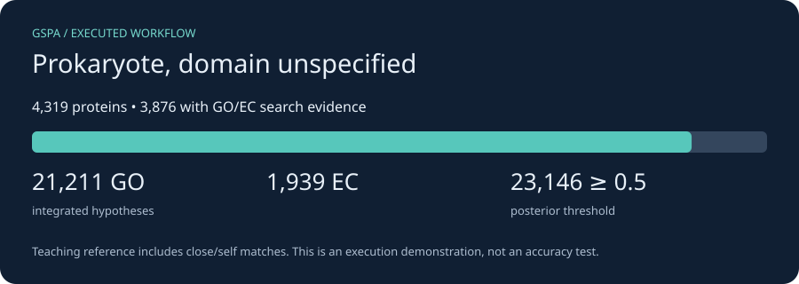

# Prokaryote with domain unspecified

*2026-10-24T14:26:32Z by Showboat 0.6.1*
<!-- showboat-id: 92ccac48-ab3d-44d1-8b32-298381d2aa63 -->

The same E. coli teaching genome is analyzed without providing its domain, to show the prokaryote preset. It does not silently choose bacterial essentials or assert bacterial taxonomy. In real work, prefer bacteria or archaea when the domain is known.

First complete [installation](install.md) and [data and resource setup](resources.md). Run every command from the checkout root; each command starts a new CPU container. Outputs persist in `.tutorial-work/prokaryote/`.

The compact teaching reference contains reviewed proteins from these same organisms, including self/close matches. These runs prove the workflow executes; they do not estimate accuracy. We use one DIAMOND hit per query and disable optional domain/neural predictors. No ontology was downloaded, so ontology-based quality metrics and ancestor relaxation are not demonstrated here; integration uses bundled constraint tables.

```bash
docker run --rm -i --user "$(id -u):$(id -g)" --cpus 2 --memory 6g \
  -v "$PWD/.tutorial-work:/work" -v "$PWD/tutorials/workflows:/tutorial:ro" \
  gspa-tutorial:cpu bash -eu <<'GSPA'
gspa integrate --preset prokaryote --print-config > /work/prokaryote-settings.json
python3 - <<'PYCONFIG'
import json
settings = json.load(open('/work/prokaryote-settings.json'))
for key in ['--taxon', '--essential-profile', '--enable-priors', '--enforce-stage2', '--lite']:
    print(key + ': ' + str(settings[key]))
PYCONFIG
GSPA
```

```output
--taxon: None
--essential-profile: None
--enable-priors: coherence,consistency,anatomical,gap_filling,genomic_context
--enforce-stage2: True
--lite: True
```

Call genes where needed and search the annotation-bearing DIAMOND database. Logs retain the tool commands and diagnostics. Conversion keeps unique direct DIAMOND GO/EC claims; operon-propagated suggestions in the annotation TSV are excluded, because operon coordinates are supplied separately to integration. This avoids counting the same context twice. Its teaching score is percent identity / 100 clipped to [0.01, 0.99], not a calibrated likelihood. For production, use held-out calibration and a broader reference, and add independent predictors.

```bash
docker run --rm -i --user "$(id -u):$(id -g)" --cpus 2 --memory 6g \
  -v "$PWD/.tutorial-work:/work" -v "$PWD/tutorials/workflows:/tutorial:ro" \
  gspa-tutorial:cpu bash -eu <<'GSPA'
mkdir -p /work/prokaryote/gspa_out
gspa annotate --preset prokaryote --genome /work/data/bacteria.fna \
  -c /work/data/cpu.json --db /work/data/reference.dmnd \
  -o /work/prokaryote/annot -t 2 > /work/prokaryote/annotate.log 2>&1 || { tail -60 /work/prokaryote/annotate.log; exit 1; }
python3 /tutorial/results.py claims prokaryote
GSPA
```

```output
23,189 unique DIAMOND GO/EC claims from 3,876 proteins
Teaching score: DIAMOND identity fraction, clipped to [0.01, 0.99]; not a fitted probability.
```

Integrate the claims and retain provenance. Without a GO ontology, cellular consistency enforcement can remove incompatible terms but cannot relax them to an ancestor. Mixed-community and phage runs deliberately use evidence alone. The results below are counts of hypotheses, not validated functions.

```bash
docker run --rm -i --user "$(id -u):$(id -g)" --cpus 2 --memory 6g \
  -v "$PWD/.tutorial-work:/work" -v "$PWD/tutorials/workflows:/tutorial:ro" \
  gspa-tutorial:cpu bash -eu <<'GSPA'
gspa integrate --preset prokaryote --operons /work/prokaryote/annot/operons_for_integrate.tsv \
  --claims /work/prokaryote/claims.jsonl --out /work/prokaryote/gspa_out/integrated.tsv \
  --provenance /work/prokaryote/gspa_out/provenance.json \
  --enforcement-actions-out /work/prokaryote/gspa_out/actions.tsv \
  > /work/prokaryote/integrate.log 2>&1 || { tail -60 /work/prokaryote/integrate.log; exit 1; }
python3 /tutorial/results.py summary prokaryote
GSPA
```

```output
Proteins: 4,319; with GO/EC search evidence: 3,876
Integrated hypotheses: GO=21,211; EC=1,939
Hypotheses at posterior >= 0.5: 23,146
These counts describe this teaching reference; they are not accuracy or completeness estimates.
```

```bash {image}

```



Build the interactive GSPA browser. The adapter supplies its expected metadata layout from the actual GSPA CDS coordinates (or protein IDs for yeast); it does not run Prokka or invent gene positions. GO/EC IDs remain visible because this compact example has no term-label ontology. The annotations table works locally; the genome tab may need internet access for igv.js.

```bash
docker run --rm -i --user "$(id -u):$(id -g)" --cpus 2 --memory 6g \
  -v "$PWD/.tutorial-work:/work" -v "$PWD/tutorials/workflows:/tutorial:ro" \
  gspa-tutorial:cpu bash -eu <<'GSPA'
python3 /tutorial/results.py browser prokaryote
gspa visualize -w /work/prokaryote -g prokaryote \
  --go-obo /work/data/no-labels.obo --ec2go /work/data/no-ec-labels.txt \
  --fasta /work/data/bacteria.fna \
  > /work/prokaryote/visualize.log 2>&1 || { tail -60 /work/prokaryote/visualize.log; exit 1; }
test -s /work/prokaryote/gspa_out/prokaryote_browser.html
printf 'Interactive browser generated successfully.\n'
GSPA
```

```output
Browser metadata prepared from real CDS coordinates / supplied protein identifiers.
Interactive browser generated successfully.
```

Open `.tutorial-work/prokaryote/gspa_out/prokaryote_browser.html` in your browser. Inspect `integrated.tsv` for final hypotheses, `provenance.json` for supporting evidence, and `actions.tsv` when enforcement acts. Keep the logs and `data/downloads.json` alongside results. For an actual project, replace the input and reference database; retain the biological assumptions appropriate to your unit of analysis.

Re-run this document with `uvx showboat verify docs/tutorials/prokaryote.md` after installation and resource setup.
