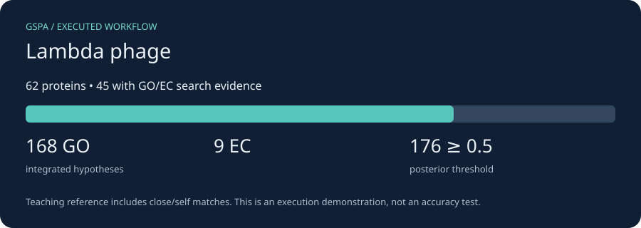

# Virus/phage: bacteriophage lambda

*2026-10-24T14:26:27Z by Showboat 0.6.1*
<!-- showboat-id: 3e72f36c-afe9-4bc0-a8ec-e2d6caf152d4 -->

The complete lambda genome, ENA [J02459.1](https://www.ebi.ac.uk/ena/browser/view/J02459.1). There is currently no virus workflow preset: this tutorial records explicit viral settings. It uses Prodigal meta mode, no cellular completeness assumptions, no operon/pathway inference and evidence-only integration. This gene-calling example is for a bacterial dsDNA phage with genetic code 11; it is not a universal RNA-virus or alternative-code workflow. Supply externally called proteins for those cases.

First complete [installation](install.md) and [data and resource setup](resources.md). Run every command from the checkout root; each command starts a new CPU container. Outputs persist in `.tutorial-work/virus/`.

The compact teaching reference contains reviewed proteins from these same organisms, including self/close matches. These runs prove the workflow executes; they do not estimate accuracy. We use one DIAMOND hit per query and disable optional domain/neural predictors. No ontology was downloaded, so ontology-based quality metrics and ancestor relaxation are not demonstrated here; integration uses bundled constraint tables.

```bash
docker run --rm -i --user "$(id -u):$(id -g)" --cpus 2 --memory 6g \
  -v "$PWD/.tutorial-work:/work" -v "$PWD/tutorials/workflows:/tutorial:ro" \
  gspa-tutorial:cpu bash -eu <<'GSPA'
python3 -m json.tool /work/data/virus.json
GSPA
```

```output
{
    "predictors": {
        "domains": {
            "enabled": false
        },
        "neural": {
            "basePredictor": "none"
        },
        "similarity": {
            "maxTargetSeqs": 1
        },
        "operons": {
            "enabled": false
        },
        "pathway": {
            "enabled": false
        },
        "localization": {
            "enabled": false
        }
    },
    "integration": {
        "enabled": false
    },
    "quality": {
        "enabled": false,
        "completeness": {
            "profile": "skip"
        },
        "consistency": {
            "enforce": false
        },
        "coherence": {
            "enforce": false
        }
    }
}
```

Call genes where needed and search the annotation-bearing DIAMOND database. Logs retain the tool commands and diagnostics. Conversion keeps unique direct DIAMOND GO/EC claims; operon-propagated suggestions in the annotation TSV are excluded, because operon coordinates are supplied separately to integration. This avoids counting the same context twice. Its teaching score is percent identity / 100 clipped to [0.01, 0.99], not a calibrated likelihood. For production, use held-out calibration and a broader reference, and add independent predictors.

```bash
docker run --rm -i --user "$(id -u):$(id -g)" --cpus 2 --memory 6g \
  -v "$PWD/.tutorial-work:/work" -v "$PWD/tutorials/workflows:/tutorial:ro" \
  gspa-tutorial:cpu bash -eu <<'GSPA'
mkdir -p /work/virus/gspa_out
gspa annotate -k virus --mag --genome /work/data/virus.fna \
  -c /work/data/virus.json --db /work/data/reference.dmnd \
  -o /work/virus/annot -t 2 > /work/virus/annotate.log 2>&1 || { tail -60 /work/virus/annotate.log; exit 1; }
python3 /tutorial/results.py claims virus
GSPA
```

```output
177 unique DIAMOND GO/EC claims from 45 proteins
Teaching score: DIAMOND identity fraction, clipped to [0.01, 0.99]; not a fitted probability.
```

Integrate the claims and retain provenance. Without a GO ontology, cellular consistency enforcement can remove incompatible terms but cannot relax them to an ancestor. Mixed-community and phage runs deliberately use evidence alone. The results below are counts of hypotheses, not validated functions.

```bash
docker run --rm -i --user "$(id -u):$(id -g)" --cpus 2 --memory 6g \
  -v "$PWD/.tutorial-work:/work" -v "$PWD/tutorials/workflows:/tutorial:ro" \
  gspa-tutorial:cpu bash -eu <<'GSPA'
gspa integrate --lite --enable-priors "" --no-enforce-stage2 \
  --claims /work/virus/claims.jsonl --out /work/virus/gspa_out/integrated.tsv \
  --provenance /work/virus/gspa_out/provenance.json \
  --enforcement-actions-out /work/virus/gspa_out/actions.tsv \
  > /work/virus/integrate.log 2>&1 || { tail -60 /work/virus/integrate.log; exit 1; }
python3 /tutorial/results.py summary virus
GSPA
```

```output
Proteins: 62; with GO/EC search evidence: 45
Integrated hypotheses: GO=168; EC=9
Hypotheses at posterior >= 0.5: 176
These counts describe this teaching reference; they are not accuracy or completeness estimates.
```

```bash {image}

```



Build the interactive GSPA browser. The adapter supplies its expected metadata layout from the actual GSPA CDS coordinates (or protein IDs for yeast); it does not run Prokka or invent gene positions. GO/EC IDs remain visible because this compact example has no term-label ontology. The annotations table works locally; the genome tab may need internet access for igv.js.

```bash
docker run --rm -i --user "$(id -u):$(id -g)" --cpus 2 --memory 6g \
  -v "$PWD/.tutorial-work:/work" -v "$PWD/tutorials/workflows:/tutorial:ro" \
  gspa-tutorial:cpu bash -eu <<'GSPA'
python3 /tutorial/results.py browser virus
gspa visualize -w /work/virus -g virus \
  --go-obo /work/data/no-labels.obo --ec2go /work/data/no-ec-labels.txt \
  --fasta /work/data/virus.fna \
  > /work/virus/visualize.log 2>&1 || { tail -60 /work/virus/visualize.log; exit 1; }
test -s /work/virus/gspa_out/virus_browser.html
printf 'Interactive browser generated successfully.\n'
GSPA
```

```output
Browser metadata prepared from real CDS coordinates / supplied protein identifiers.
Interactive browser generated successfully.
```

Open `.tutorial-work/virus/gspa_out/virus_browser.html` in your browser. Inspect `integrated.tsv` for final hypotheses, `provenance.json` for supporting evidence, and `actions.tsv` when enforcement acts. Keep the logs and `data/downloads.json` alongside results. For an actual project, replace the input and reference database; retain the biological assumptions appropriate to your unit of analysis.

Re-run this document with `uvx showboat verify docs/tutorials/virus.md` after installation and resource setup.
